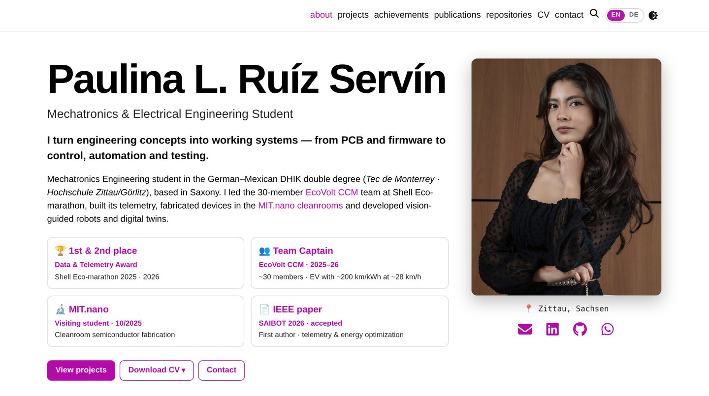

# Paulina L. Ruíz Servín — Engineering Portfolio

<div align="center">

**Mechatronics & Electrical Engineering student · Embedded systems, electronics, control & industrial automation**

[**paulinism.github.io**](https://paulinism.github.io/) · [**Deutsche Version**](https://paulinism.github.io/de/) · [LinkedIn](https://www.linkedin.com/in/pruizservin27/)

[](https://github.com/paulinism/paulinism.github.io/actions/workflows/deploy.yml)

[](https://paulinism.github.io/)

</div>

Personal portfolio of **Paulina Lilian Ruíz Servín**, student in the German–Mexican **DHIK double degree**: B.Eng. Electrical Engineering at Hochschule Zittau/Görlitz and B.Sc. Mechatronics at Tecnológico de Monterrey (fully taught in English). The site documents projects in embedded systems, PCB design, control, computer vision and industrial automation. It also covers the work as Team Captain of the **EcoVolt CCM EV Racing Team** (Shell Eco-marathon) and a cleanroom program at **MIT.nano**. It supports applications for an internship in Germany from February/March 2027.

The site is built on the [al-folio](https://github.com/alshedivat/al-folio) v1 Jekyll starter and has been heavily customized. This README describes what changed compared to the original template.

---

## Site map

Every page exists in English and German. A **EN | DE** switch in the navigation bar jumps between the two versions of the same page.

| Page         | English                                                     | Deutsch                                                           | Content                                                                    |
| ------------ | ----------------------------------------------------------- | ----------------------------------------------------------------- | -------------------------------------------------------------------------- |
| Home         | [/](https://paulinism.github.io/)                           | [/de/](https://paulinism.github.io/de/)                           | Profile, key results, skills, tech stack, featured projects, photo gallery |
| Projects     | [/projects/](https://paulinism.github.io/projects/)         | [/de/projects/](https://paulinism.github.io/de/projects/)         | 7 technical write-ups (extracurricular & research, academic)               |
| Achievements | [/achievements/](https://paulinism.github.io/achievements/) | [/de/achievements/](https://paulinism.github.io/de/achievements/) | Awards, research, certifications, flippable certificate viewer             |
| Publications | [/publications/](https://paulinism.github.io/publications/) | [/de/publications/](https://paulinism.github.io/de/publications/) | IEEE SAIBOT 2026 paper (accepted, first author) and technical reports      |
| Repositories | [/repositories/](https://paulinism.github.io/repositories/) | [/de/repositories/](https://paulinism.github.io/de/repositories/) | Telemetry firmware and SCARA vision code                                   |
| CV           | [/cv/](https://paulinism.github.io/cv/)                     | [/de/cv/](https://paulinism.github.io/de/cv/)                     | Web CV plus downloadable 2-page PDFs (DE/EN)                               |
| Contact      | [/contact/](https://paulinism.github.io/contact/)           | [/de/contact/](https://paulinism.github.io/de/contact/)           | Availability, e-mail, phone, LinkedIn, WhatsApp                            |

### Projects

| Project                                                   | Highlights                                                                                     |
| --------------------------------------------------------- | ---------------------------------------------------------------------------------------------- |
| Telemetry & Energy-Optimization Platform (EcoVolt CCM)    | Altium PCBs, C/C++ ESP32 firmware, CAN, HIL bench · Data & Telemetry Award 1st 2025 / 2nd 2026 |
| Automated PPE & Inventory Management System (EcoVolt CCM) | QR codes, Python/OpenCV pilot, web dashboard                                                   |
| Semiconductor Microfabrication — MIT.nano                 | Solar cell, MEMS cantilever, microfluidic mixer; lithography, PECVD/PVD, etching               |
| Digital Twin of a Flexible CNC Manufacturing Cell (ORZA)  | TIA Portal / S7-1500, WinCC, Process Simulate, virtual commissioning, UR5, Cognex              |
| Vision-Guided SCARA Pick-and-Place Robot                  | Control PCB, PID in Simulink, Python vision with YOLOv11n, MQTT                                |
| Automated Viscosity Measurement System (Endress+Hauser)   | Op-amp measurement chain, three Altium PCBs, ESP32, LabVIEW, OpenPLC                           |
| Scissor Lift & AGV Platform                               | SolidWorks/NX, 3D-printed cam, machined parts, load-cell amplifier                             |

---

## What changed compared to the original al-folio template

### Bilingual site (EN/DE)

- German versions of every page in `_pages/de/` and of every project in `_pages/de/projects/`.
- `assets/js/lang-switch.js` adds the **EN | DE** switch (placed before the theme toggle) and translates the navigation labels.
- German pages link to the German LinkedIn profile (`?locale=de-DE`).

### Home page (`_pages/about.md`, `_pages/de/about.md`)

- Hero with full name, role, photo, location and social icons (e-mail, LinkedIn, GitHub, WhatsApp).
- Four result cards with the same layout: awards, Team Captain (~30 members, EV with ~200 km/kWh at ~28 km/h), MIT.nano and the IEEE paper.
- Full-width availability banner followed by **six compact skill boxes** (embedded, PCB & measurement, control, automation, vision & data, design & fabrication).
- **Tech Stack**: three cards with 27 tool logos (design & simulation, programming & automation, software & tools), stored in `assets/img/logos/`.
- **Featured projects** cards show the key tools of each project, read from the `tools:` list in each project's front matter.
- Photo gallery ("On track, in the lab, on stage") where each photo links to its project. The Vehicle Design photo opens the ergonomics section directly.
- Section titles in a common style (theme color, icon, underline) and Contact / All projects buttons at the bottom.

### Projects

- Redesigned overview page with a featured card, badges and tool tags per project.
- Every project page follows the same structure: results first, challenge, my contribution, tools, results & lessons, evidence. Pages include "design at a glance" figures.
- Click-to-zoom on all images (medium-zoom), plus "Back to projects" and previous/next navigation.

### Achievements, Publications, Repositories, CV, Contact

- All pages share the same large page title, short introduction and section-heading style.
- **Achievements:** KPI strip, award cards with photos and prize, research summaries, certificates grouped by electrical engineering, automation and Shell Eco-marathon, and a book-style flippable certificate viewer.
- **Publications:** conference paper card (IEEE SAIBOT 2026, accepted) with BibTeX, and technical reports.
- **Repositories:** curated cards for `Ecovolt_telemetry_final` and `ScaraCV` with tags and links to the project pages.
- **CV:** redesigned web CV (`_data/cv.yml`) and downloadable PDFs in `assets/pdf/` (`CV_Paulina_DE.pdf`, `CV_Paulina_EN.pdf`). Download links carry a `?v=` version so visitors always get the latest PDF.
- **Contact:** icon rows for each channel, square profile photo and location button.

### Layout, performance and build

- Footer shows the name and social icons only; the hosting/template credit line was removed.
- Images resized to a maximum of 1600 px and recompressed; project cards use JPEG; unused MathJax and badge scripts are disabled.
- `.github/workflows/preview-build.yml` builds `preview/**` branches into an unserved `preview-site` branch to review changes before publishing.
- `.github/workflows/deploy.yml` runs on `ubuntu-24.04`, because Ruby 3.3.5 is not available on the newer runner image.

---

## Where to edit

| What                                  | File(s)                                                |
| ------------------------------------- | ------------------------------------------------------ |
| Home page                             | `_pages/about.md`, `_pages/de/about.md`                |
| Project write-ups                     | `_projects/*.md` (EN), `_pages/de/projects/*.md` (DE)  |
| Tools shown on featured project cards | `tools:` in the front matter of each project           |
| Other pages                           | `_pages/<page>.md` and `_pages/de/<page>.md`           |
| CV data and PDFs                      | `_data/cv.yml`, `assets/pdf/`                          |
| Logos, photos                         | `assets/img/logos/`, `assets/img/home/`, `assets/img/` |
| Site settings, plugins                | `_config.yml`, `Gemfile` (both lists must match)       |

## Local development

```bash
bundle install
bundle exec jekyll serve      # http://localhost:4000/
npm ci && npm run lint:prettier
```

Pushing to `main` deploys the site with GitHub Actions (`Deploy site`) to the `gh-pages` branch. Template documentation (installation, configuration, plugins) is in [`docs/`](docs/) and in the [al-folio repository](https://github.com/alshedivat/al-folio).

## Credits and license

- Built with [Jekyll](https://jekyllrb.com/) on the [al-folio](https://github.com/alshedivat/al-folio) starter (MIT License, see [`LICENSE`](LICENSE)).
- Generic tool icons from [devicon](https://devicon.dev/) (MIT) and [Simple Icons](https://simpleicons.org/) (CC0). Product logos are trademarks of their respective owners and are shown only to name the tools used.
- Text, photos, project content and CV documents © Paulina Lilian Ruíz Servín.
