

<section class="hero">
  

    <h1 class="hero-name">Paulina L. Ruíz Servín</h1>
    
Mechatronics &amp; Electrical Engineering Student

    
I turn engineering concepts into working systems — from PCB and firmware to control, automation and testing.

    
Mechatronics Engineering student in the German–Mexican DHIK double degree (<em>Tec de Monterrey</em> · <em>Hochschule Zittau/Görlitz</em>), based in Saxony. I led the 30-member <a href="https://www.instagram.com/ecovoltccm/">EcoVolt CCM</a> team at Shell Eco-marathon, built its telemetry, fabricated devices in the <a href="https://global.mit.edu/news-stories/nanolab-workshop-builds-student-skills-and-strengthens-international-ties/">MIT.nano cleanrooms</a> and developed vision-guided robots and digital twins.

  
🏆 1st &amp; 2nd placeData &amp; Telemetry AwardShell Eco-marathon 2025 · 2026

  
👥 Team CaptainEcoVolt CCM · 2025–26~30 members · EV with ~200 km/kWh at ~28 km/h

  
🔬 MIT.nanoVisiting student · 10/2025Cleanroom semiconductor fabrication

  
📄 IEEE paperSAIBOT 2026 · acceptedFirst author · telemetry &amp; energy optimization

    

      <a class="ab-btn primary" href="/projects/">View projects</a>
      

        
Download CV

        

          <a href="/assets/pdf/CV_Paulina_EN.pdf?v=20261106" target="_blank" rel="noopener">English (PDF)</a>
          <a href="/assets/pdf/CV_Paulina_DE.pdf?v=20261106" target="_blank" rel="noopener">Deutsch (PDF)</a>
        

      

      <a class="ab-btn" href="/contact/">Contact</a>
    

  

  

    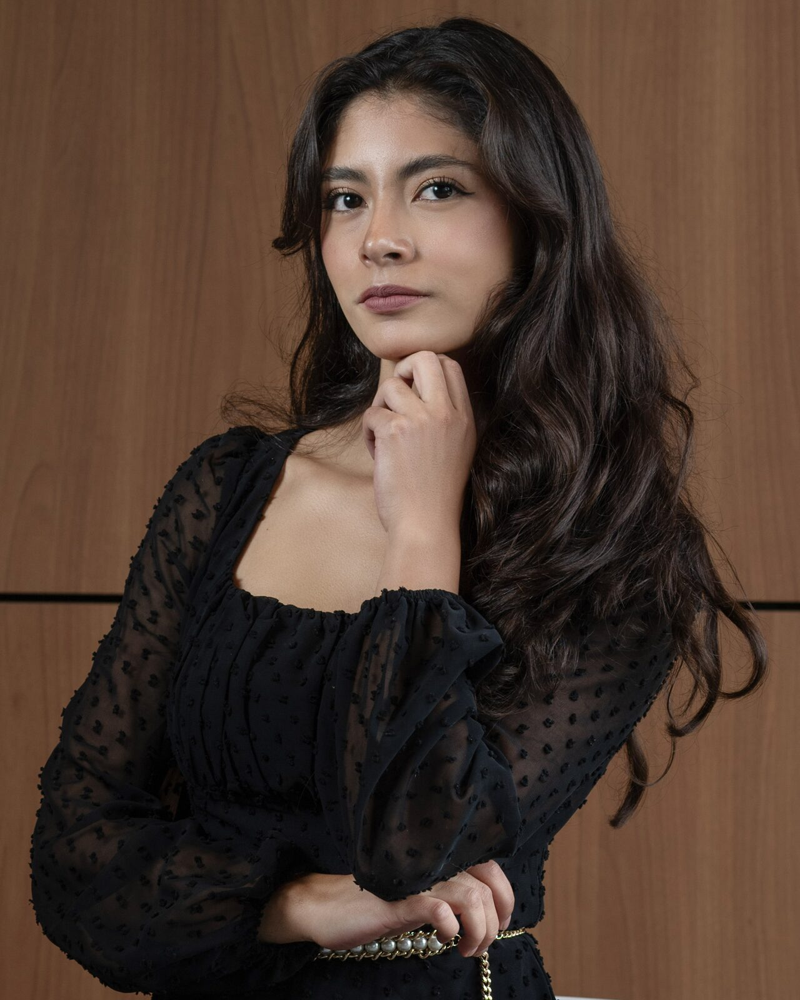
    
📍 Zittau, Sachsen

    

      <a href="mailto:pruizservin27@gmail.com" title="Email" aria-label="Email"><i class="fa-solid fa-envelope"></i></a>
      <a href="https://www.linkedin.com/in/pruizservin27/" target="_blank" rel="noopener" title="LinkedIn" aria-label="LinkedIn"><i class="fa-brands fa-linkedin"></i></a>
      <a href="https://github.com/paulinism" target="_blank" rel="noopener" title="GitHub" aria-label="GitHub"><i class="fa-brands fa-github"></i></a>
      <a href="https://wa.me/4915233878708" target="_blank" rel="noopener" title="WhatsApp" aria-label="WhatsApp"><i class="fa-brands fa-whatsapp"></i></a>
    

  

</section>

<strong>Available from February/March 2027</strong> for a mandatory internship (Praktikum) in embedded systems, hardware or industrial automation.

  
<h4><i class="fa-solid fa-microchip"></i>Embedded &amp; Electronics</h4>ESP32 firmwareCANSPI · I2C · UARTMQTTBluetoothSensor integration

  
<h4><i class="fa-solid fa-bolt"></i>PCB &amp; Measurement</h4>Multilayer PCB designIPC-2221Op-amp signal chainsCurrent sensingComponent characterizationSMD/THT soldering

  
<h4><i class="fa-solid fa-sliders"></i>Control &amp; Simulation</h4>PIDNonlinear controlTransfer functionsModel-based designMiL / HILBLDC · DC · stepper

  
<h4><i class="fa-solid fa-industry"></i>Automation &amp; Robotics</h4>PLC (S7-1500)Ladder logicHMI / SCADADigital twinVirtual commissioningCobotsModbus TCP

  
<h4><i class="fa-solid fa-eye"></i>Vision &amp; Data</h4>OpenCVObject detection (YOLO)Camera calibrationIndustrial inspectionNumPyPandasData analysis

  
<h4><i class="fa-solid fa-gears"></i>Design &amp; Fabrication</h4>CAD assembliesStatic &amp; motion analysisCAM / CNC3D printingTurning · MillingCleanroom microfabrication

<h2 class="ts-title hm-sec"><i class="fa-solid fa-screwdriver-wrench"></i> Tech Stack</h2>

Design, simulation, programming and automation tools I use in my engineering work.

  
<h3>Design &amp; Simulation</h3>

    

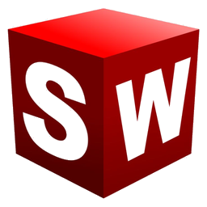
SOLIDWORKS

    

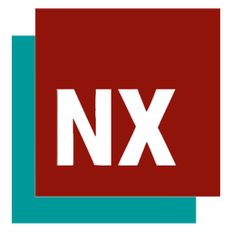
Siemens NX

    

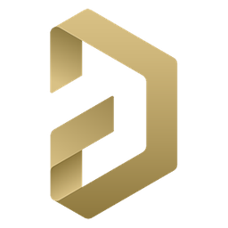
Altium Designer

    

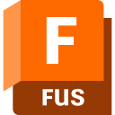
Fusion CAM

    

MATLAB

    

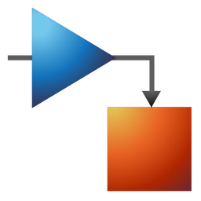
Simulink

    

Ansys

    

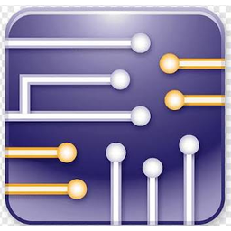
Multisim

    

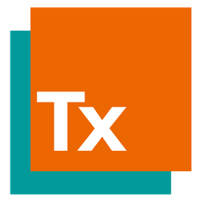
Process Simulate

  

  
<h3>Programming &amp; Automation</h3>

    

Python

    

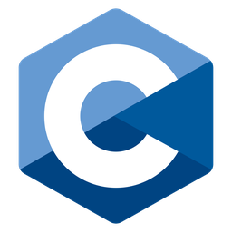
C

    

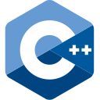
C++

    

C#

    

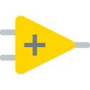
LabVIEW

    

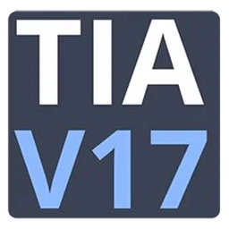
TIA Portal

    

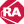
Studio 5000

    

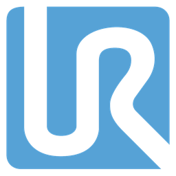
Universal Robots

    

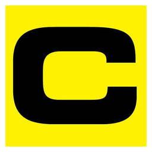
Cognex In-Sight

  

  
<h3>Software &amp; Tools</h3>

    

Word

    

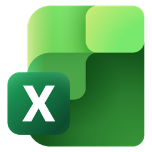
Excel

    

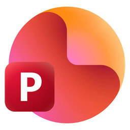
PowerPoint

    

LaTeX

    

VS Code

    

GitHub

    

Git

    

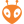
PlatformIO

    

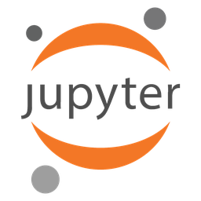
Jupyter

  

<h2 class="hm-sec" id="featured-projects"><i class="fa-solid fa-star"></i> Featured projects</h2>



  <a href="{{ project.url | relative_url }}" style="display:block; border:1px solid currentColor; border-radius:8px; overflow:hidden; text-decoration:none;">
    
    
    
    

      <h3 style="font-weight:bold; margin:0 0 0.5rem 0;">{{ project.title }}</h3>
      
{{ project.description }}

      
{{ t }}

    

  </a>


[See all projects →](/projects/)

<h2 class="hm-h hm-sec" id="highlights"><i class="fa-solid fa-camera"></i> On track, in the lab, on stage</h2>

A few moments behind the projects — competitions, cleanroom work and the hardware itself.

  <a class="hm-tile hm-big" href="/projects/ecovolt-telemetry/">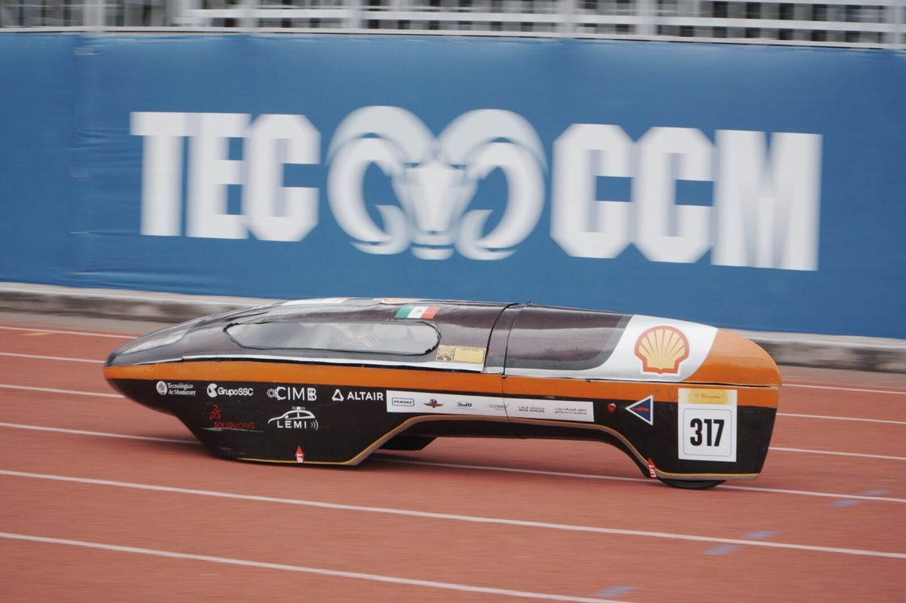<strong>EcoVolt CCM prototype</strong>Energy-efficient EV, ~200 km/kWh at ~28 km/h</a>
  <a class="hm-tile" href="/projects/mit-nano-fabrication/">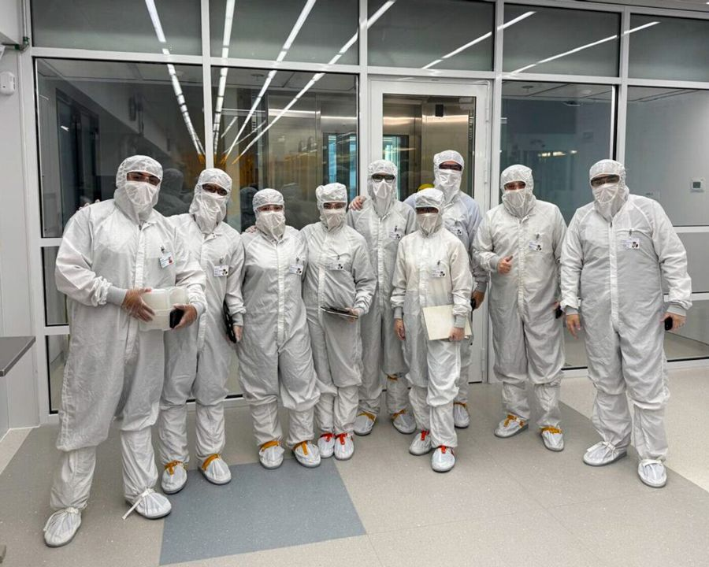<strong>MIT.nano</strong>Cleanroom microfabrication</a>
  <a class="hm-tile" href="/projects/ecovolt-telemetry/">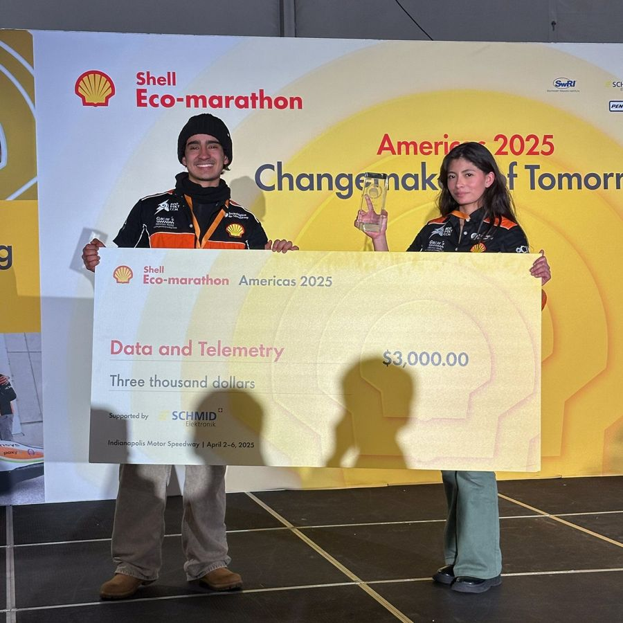<strong>1st place 2025</strong>Data &amp; Telemetry Award</a>
  <a class="hm-tile hm-wide" href="/projects/ecovolt-telemetry/#driver-ergonomics-vehicle-design-award">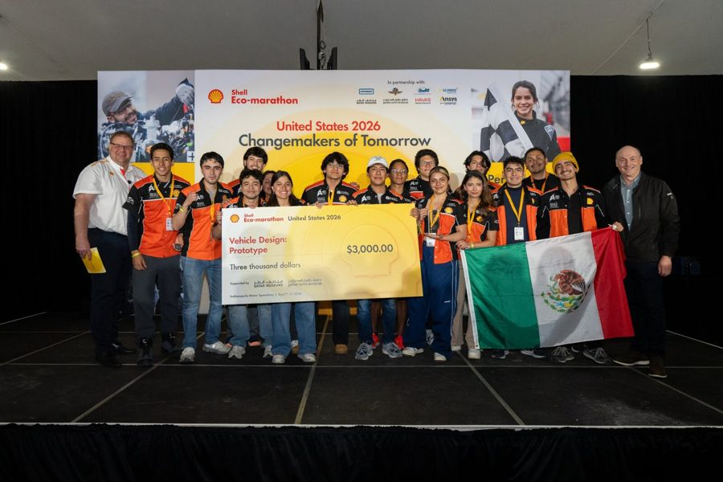<strong>Shell Eco-marathon US 2026</strong>Vehicle Design Award &amp; 2nd place Data &amp; Telemetry</a>

  <a class="btn btn-sm z-depth-0" role="button" href="{{ '/contact/' | relative_url }}">← Contact</a>
  <a class="btn btn-sm z-depth-0" role="button" href="{{ '/projects/' | relative_url }}">All projects →</a>

