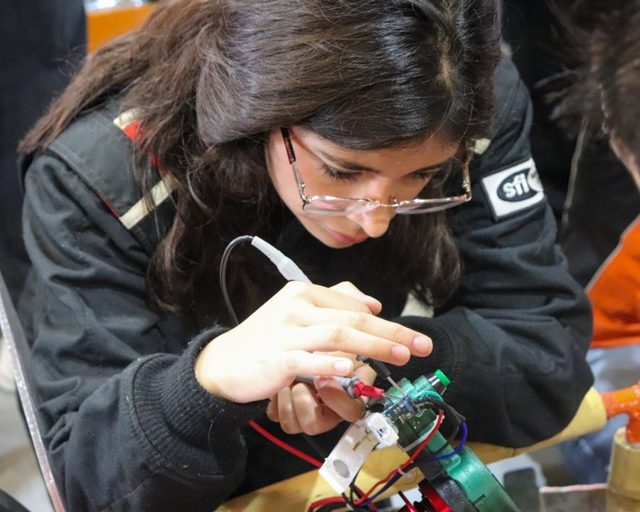
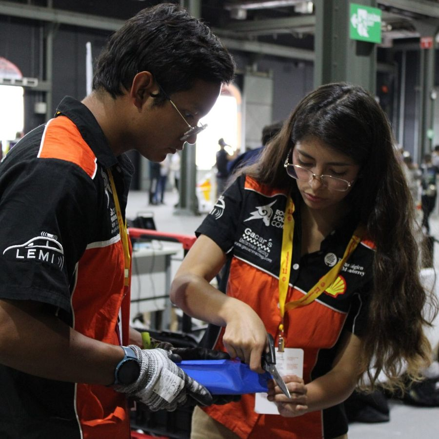
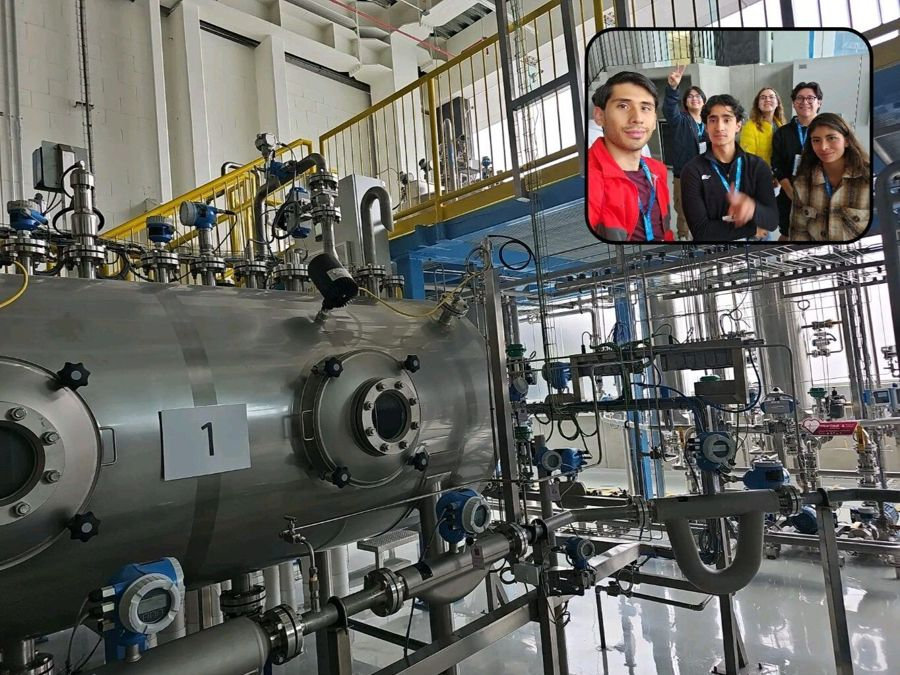
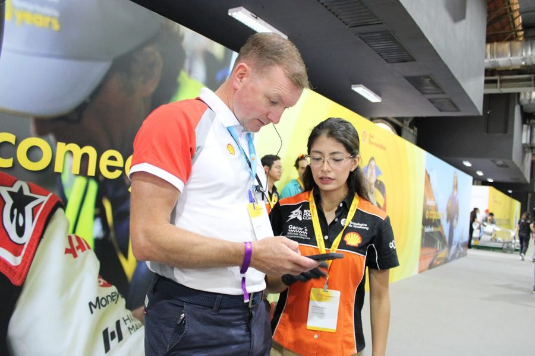
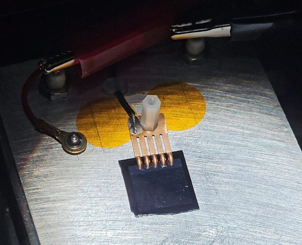
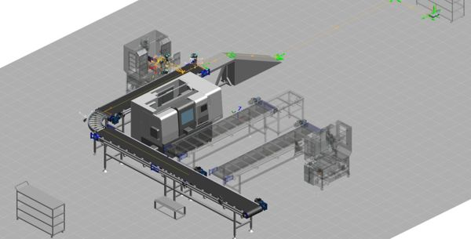
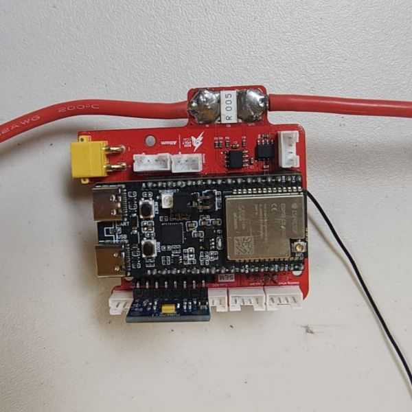

<section class="hero">
  

    <h1 class="hero-name">Paulina L. Ruíz Servín</h1>
    
Mechatronics &amp; Electrical Engineering Student

    
I turn engineering concepts into working systems — from PCB and firmware to control, automation and testing.

    
Mechatronics Engineering student in the German–Mexican DHIK double degree (<em>Tec de Monterrey</em> · <em>Hochschule Zittau/Görlitz</em>), based in Saxony. I led the 30-member <a href="https://www.instagram.com/ecovoltccm/">EcoVolt CCM</a> team at Shell Eco-marathon, built its telemetry, fabricated devices in the <a href="https://global.mit.edu/news-stories/nanolab-workshop-builds-student-skills-and-strengthens-international-ties/">MIT.nano cleanrooms</a> and developed vision-guided robots and digital twins.

  
🏆 1st &amp; 2nd placeData &amp; Telemetry Award, Shell Eco-marathon 2025 / 2026

  
👥 Team CaptainEcoVolt CCM (2025–26): led 30 members building an EV that reached ~200 km/kWh at ~28 km/h; designed the telemetry PCBs and CAN firmware

  
🔬 MIT.nanoCleanroom semiconductor fabrication

  
📄 IEEE paperFirst author, SAIBOT 2026

    

      <a class="ab-btn primary" href="/projects/">View projects</a>
      

        
Download CV

        

          <a href="/assets/pdf/CV_Paulina_EN.pdf?v=20261026" target="_blank" rel="noopener">English (PDF)</a>
          <a href="/assets/pdf/CV_Paulina_DE.pdf?v=20261026" target="_blank" rel="noopener">Deutsch (PDF)</a>
        

      

      <a class="ab-btn" href="/contact/">Contact</a>
    

  

  

    
    
📍 Zittau, Sachsen

    

      <a href="mailto:pruizservin27@gmail.com" title="Email" aria-label="Email"><i class="fa-solid fa-envelope"></i></a>
      <a href="https://www.linkedin.com/in/pruizservin27/" target="_blank" rel="noopener" title="LinkedIn" aria-label="LinkedIn"><i class="fa-brands fa-linkedin"></i></a>
      <a href="https://github.com/paulinism" target="_blank" rel="noopener" title="GitHub" aria-label="GitHub"><i class="fa-brands fa-github"></i></a>
      <a href="https://wa.me/4915233878708" target="_blank" rel="noopener" title="WhatsApp" aria-label="WhatsApp"><i class="fa-brands fa-whatsapp"></i></a>
    

  

</section>

  
<strong>Embedded &amp; Electronics</strong>ESP32C/C++CANAltium DesignerPCB designInstrumentation

  
<strong>Control &amp; Simulation</strong>MATLAB/SimulinkPythonSimscapePIDHIL

  
<strong>Automation &amp; Robotics</strong>Siemens TIA PortalRockwell PLC/HMIUR cobotsProcess SimulateCognex

  
<strong>Vision, Design &amp; Fabrication</strong>OpenCVYOLOSolidWorks CAD/CAMNXCleanroom (MIT.nano)

<strong>Available from February/March 2027</strong> for a mandatory internship (Praktikum) in embedded systems, hardware or industrial automation.

<h2 class="hm-h" id="highlights">On track, in the lab, on stage</h2>

A few moments behind the projects — competitions, cleanroom work and the hardware itself.

  <figure class="hm-tile hm-big"><figcaption><strong>EcoVolt CCM prototype</strong>Energy-efficient EV, ~200 km/kWh at ~28 km/h</figcaption></figure>
  <figure class="hm-tile"><figcaption><strong>1st place 2025</strong>Data &amp; Telemetry Award</figcaption></figure>
  <figure class="hm-tile"><figcaption><strong>Telemetry hardware</strong>Assembly &amp; bring-up</figcaption></figure>
  <figure class="hm-tile hm-wide"><figcaption><strong>Shell Eco-marathon US 2026</strong>Vehicle Design Award &amp; 2nd place Data &amp; Telemetry</figcaption></figure>
  <figure class="hm-tile"><figcaption><strong>MIT.nano</strong>Cleanroom microfabrication</figcaption></figure>
  <figure class="hm-tile"><figcaption><strong>Paddock work</strong>Vehicle electronics at the event</figcaption></figure>
  <figure class="hm-tile hm-wide"><figcaption><strong>Endress+Hauser</strong>Industry-partner viscosity project</figcaption></figure>
  <figure class="hm-tile hm-wide"><figcaption><strong>Presenting our systems</strong>Off-track awards at Shell Eco-marathon</figcaption></figure>

<h2 class="hm-h" id="experience">Experience &amp; education</h2>

  

    
08/2023 – 08/2026

    
Team Captain, Electronics Lead &amp; Mentor

    
EcoVolt CCM EV Racing Team · Shell Eco-marathon

    <ul>
      <li>Led a ~30-member team developing an energy-efficient EV that reached ~200 km/kWh at ~28 km/h</li>
      <li>Designed the telemetry PCBs in Altium and wrote the C++ ESP32 firmware (CAN, SPI, I2C, UART)</li>
      <li>Data &amp; Telemetry Award: 1st place 2025, 2nd place 2026 · Vehicle Design Award 2026</li>
    </ul>
    <a class="hm-more" href="/projects/ecovolt-telemetry/">Telemetry project →</a>
  

  

    
10/2025

    
Visiting Student — NanoLab Microfabrication Program

    
MIT.nano · Massachusetts Institute of Technology

    <ul>
      <li>Fabricated a solar cell, a MEMS cantilever and a microfluidic mixer (lithography, PECVD/PVD, etching)</li>
      <li>Characterized the devices: IV curve, mechanical and fluid tests</li>
    </ul>
    <a class="hm-more" href="/projects/mit-nano-fabrication/">MIT.nano project →</a>
  

  

    
2025 – 2026

    
Industry-partner projects

    
Endress+Hauser · ORZA Tech · with Tecnológico de Monterrey

    <ul>
      <li>Viscosity measurement electronics on three own PCBs — reliably separated 252 cP and 1676 cP</li>
      <li>Digital twin of a CNC cell: S7-1500 with a 35-step sequence, SCADA and KPIs (yield, scrap, OEE)</li>
    </ul>
    <a class="hm-more" href="/projects/">All projects →</a>
  

  

    
08/2023 – 12/2027

    
B.Sc. Mechatronics &amp; B.Eng. Electrical Engineering (DHIK double degree)

    
Tecnológico de Monterrey · Hochschule Zittau/Görlitz (since 09/2026)

    <ul>
      <li>GPA 92/100 (≈ 1.8) · 30% merit scholarship</li>
      <li>Current modules: Collaborative Robots, Neural Networks, Microcontrollers, Image Processing, Advanced Control Theory</li>
    </ul>
  

## Featured projects



  <a href="{{ project.url | relative_url }}" style="display:block; border:1px solid currentColor; border-radius:8px; overflow:hidden; text-decoration:none;">
    
    
    
    

      <h3 style="font-weight:bold; margin:0 0 0.5rem 0;">{{ project.title }}</h3>
      
{{ project.description }}

    

  </a>


[See all projects →](/projects/)
