

<section class="hero">
  

    <h1 class="hero-name">Paulina L. Ruíz Servín</h1>
    
Studentin der Mechatronik &amp; Elektrotechnik

    
Ich mache aus technischen Konzepten funktionierende Systeme — von Platine und Firmware bis zu Regelung, Automatisierung und Test.

    
Mechatronik-Studentin im deutsch-mexikanischen DHIK-Doppelabschluss (<em>Tec de Monterrey</em> · <em>Hochschule Zittau/Görlitz</em>), wohnhaft in Sachsen. Ich habe das 30-köpfige Team <a href="https://www.instagram.com/ecovoltccm/">EcoVolt CCM</a> beim Shell Eco-marathon geleitet, seine Telemetrie aufgebaut, in den <a href="https://global.mit.edu/news-stories/nanolab-workshop-builds-student-skills-and-strengthens-international-ties/">Reinräumen von MIT.nano</a> Bauelemente gefertigt und kamerageführte Roboter sowie digitale Zwillinge entwickelt.

  
🏆 1. &amp; 2. PlatzData &amp; Telemetry Award, Shell Eco-marathon 2025 / 2026

  
👥 TeamkapitäninEcoVolt CCM (2025–26): Leitung von 30 Mitgliedern, Fahrzeug mit ca. 200 km/kWh bei ca. 28 km/h; Telemetrie-Platinen und CAN-Firmware entwickelt

  
🔬 MIT.nanoHalbleiterfertigung im Reinraum

  
📄 IEEE-PaperErstautorin, SAIBOT 2026

    

      <a class="ab-btn primary" href="/de/projects/">Projekte ansehen</a>
      

        
Lebenslauf herunterladen

        

          <a href="/assets/pdf/CV_Paulina_DE.pdf?v=20261026" target="_blank" rel="noopener">Deutsch (PDF)</a>
          <a href="/assets/pdf/CV_Paulina_EN.pdf?v=20261026" target="_blank" rel="noopener">English (PDF)</a>
        

      

      <a class="ab-btn" href="/de/contact/">Kontakt</a>
    

  

  

    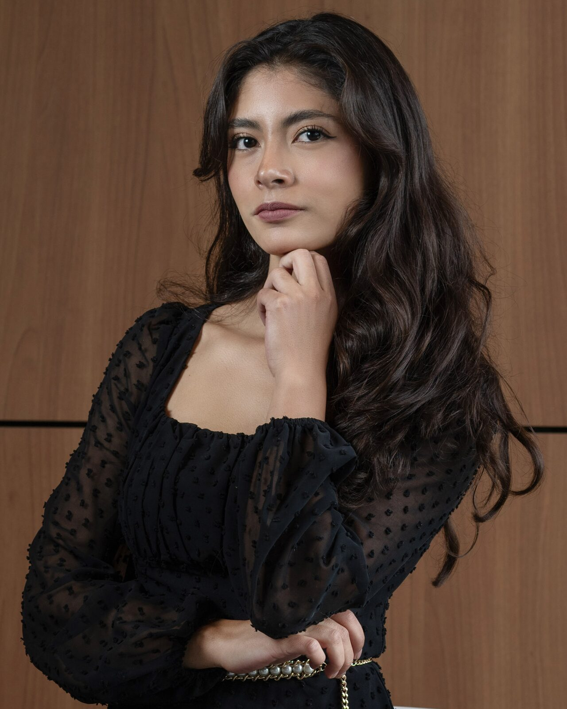
    
📍 Zittau, Sachsen

    

      <a href="mailto:pruizservin27@gmail.com" title="E-Mail" aria-label="E-Mail"><i class="fa-solid fa-envelope"></i></a>
      <a href="https://www.linkedin.com/in/pruizservin27/?locale=de-DE" target="_blank" rel="noopener" title="LinkedIn" aria-label="LinkedIn"><i class="fa-brands fa-linkedin"></i></a>
      <a href="https://github.com/paulinism" target="_blank" rel="noopener" title="GitHub" aria-label="GitHub"><i class="fa-brands fa-github"></i></a>
      <a href="https://wa.me/4915233878708" target="_blank" rel="noopener" title="WhatsApp" aria-label="WhatsApp"><i class="fa-brands fa-whatsapp"></i></a>
    

  

</section>

<h2 class="hm-h" id="skills">Kenntnisse</h2>

Woran ich arbeite — und mit welchen Werkzeugen.

  
<i class="fa-solid fa-microchip"></i><h3>Embedded Systems &amp; Firmware</h3>
ESP32-Firmware in C/C++ für Telemetrie und Roboter: Bustreiber, Datenaufzeichnung und Funkverbindungen.

ESP32C/C++CANSPI · I2C · UARTMQTTPlatformIOGit

  
<i class="fa-solid fa-bolt"></i><h3>Platinenentwurf &amp; Elektronik</h3>
Vom Schaltplan bis zur Inbetriebnahme in Altium: Messketten, Strommessung, Mehrlagenplatinen und SMD/THT-Bestückung.

Altium DesignerMultisimOPV-SchaltungenINA240LötenLaborgeräteLabVIEW

  
<i class="fa-solid fa-sliders"></i><h3>Regelung &amp; Simulation</h3>
Modellbasierte Entwicklung: Übertragungsfunktionen, PID-Regelkreise und Model-/Hardware-in-the-Loop-Tests.

MATLABSimulinkSimscapePIDMiL / HiL

  
<i class="fa-solid fa-industry"></i><h3>Industrielle Automatisierung</h3>
SPS-Ablaufketten, HMI/SCADA und virtuelle Inbetriebnahme eines digitalen Zwillings mit Cobots.

TIA PortalS7-1500WinCCPLCSIM Adv.Process SimulateUR-Cobots

  
<i class="fa-solid fa-eye"></i><h3>Bildverarbeitung &amp; Daten</h3>
Bildverarbeitung in Python, Objekterkennung, industrielle Prüfung und Datenanalyse.

PythonOpenCVYOLOv11Cognex In-SightNumPy · PandasAltair AI Studio

  
<i class="fa-solid fa-gears"></i><h3>Konstruktion &amp; Fertigung</h3>
CAD-Baugruppen, Bewegungs- und Festigkeitsanalysen, CAM und praktische Fertigung bis zum Reinraum.

SolidWorks (CSWA)Siemens NXCAM3D-DruckDrehen · FräsenReinraum

<strong>Verfügbar ab Februar/März 2027</strong> für ein Praktikum in Embedded Systems, Hardware oder industrieller Automatisierung.

<h2 class="hm-h" id="tech-stack">Tech-Stack</h2>

Software und Sprachen, die ich in Projekten, Wettbewerben und im Studium eingesetzt habe.

<h3>Konstruktion &amp; Simulation</h3>

  

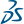
SolidWorks

  

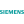
Siemens NX

  

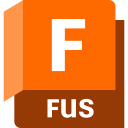
Fusion CAM

  

Ansys

  

MATLAB

  

<i class="fa-solid fa-diagram-project"></i>
Simulink

  

<i class="fa-solid fa-microchip"></i>
Altium Designer

  

<i class="fa-solid fa-wave-square"></i>
Multisim

  

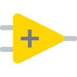
LabVIEW

<h3>Automatisierung &amp; Robotik</h3>

  

TIA Portal

  

Process Simulate

  

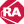
Rockwell Studio 5000

  

<i class="fa-solid fa-robot"></i>
Universal Robots

  

<i class="fa-solid fa-camera"></i>
Cognex In-Sight

<h3>Programmierung &amp; Daten</h3>

  

Python

  

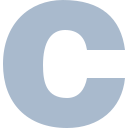
C

  

C++

  

C#

  

NumPy

  

Pandas

  

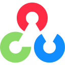
OpenCV

  

YOLO

  

Jupyter

<h3>Embedded &amp; Tools</h3>

  

ESP32

  

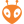
PlatformIO

  

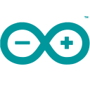
Arduino

  

MQTT

  

Git

  

GitHub

  

VS Code

  

LaTeX

  

<i class="fa-solid fa-cube"></i>
3D-Druck

<h2 class="hm-h" id="highlights">Auf der Strecke, im Labor, auf der Bühne</h2>

Einige Momente hinter den Projekten — Wettbewerbe, Reinraumarbeit und die Hardware selbst.

  <figure class="hm-tile hm-big">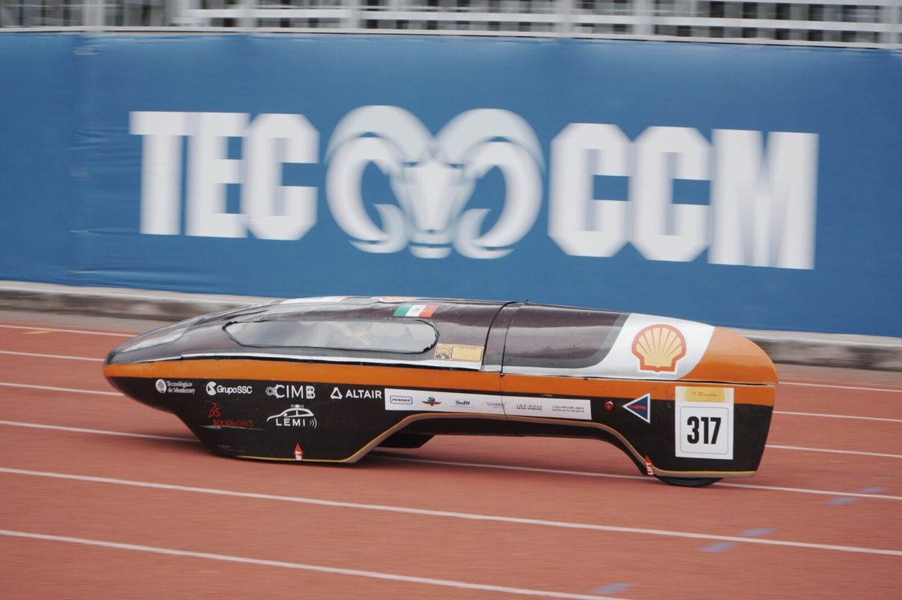<figcaption><strong>Prototyp EcoVolt CCM</strong>Energieeffizientes E-Fahrzeug, ca. 200 km/kWh bei ca. 28 km/h</figcaption></figure>
  <figure class="hm-tile">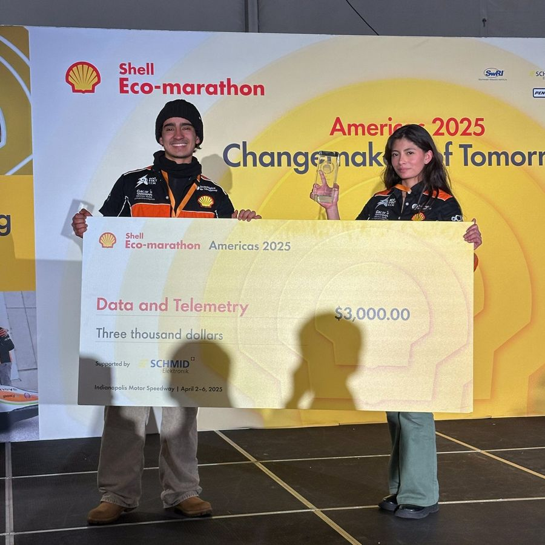<figcaption><strong>1. Platz 2025</strong>Data &amp; Telemetry Award</figcaption></figure>
  <figure class="hm-tile">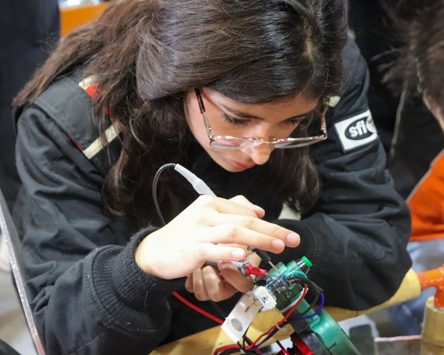<figcaption><strong>Telemetrie-Hardware</strong>Bestückung &amp; Inbetriebnahme</figcaption></figure>
  <figure class="hm-tile hm-wide">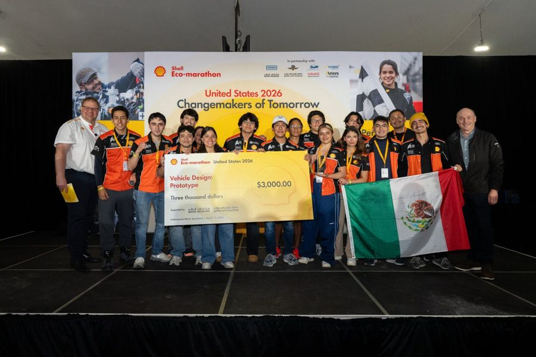<figcaption><strong>Shell Eco-marathon US 2026</strong>Vehicle Design Award &amp; 2. Platz Data &amp; Telemetry</figcaption></figure>
  <figure class="hm-tile">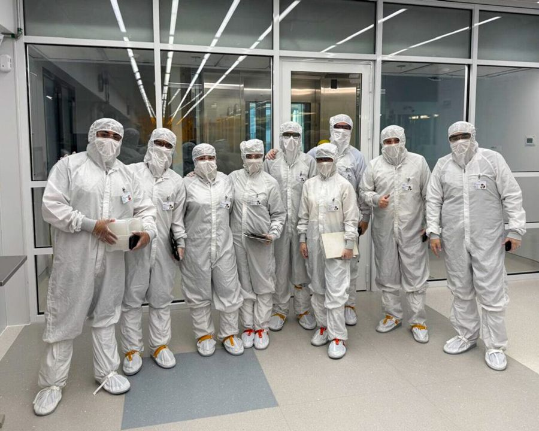<figcaption><strong>MIT.nano</strong>Mikrofertigung im Reinraum</figcaption></figure>
  <figure class="hm-tile">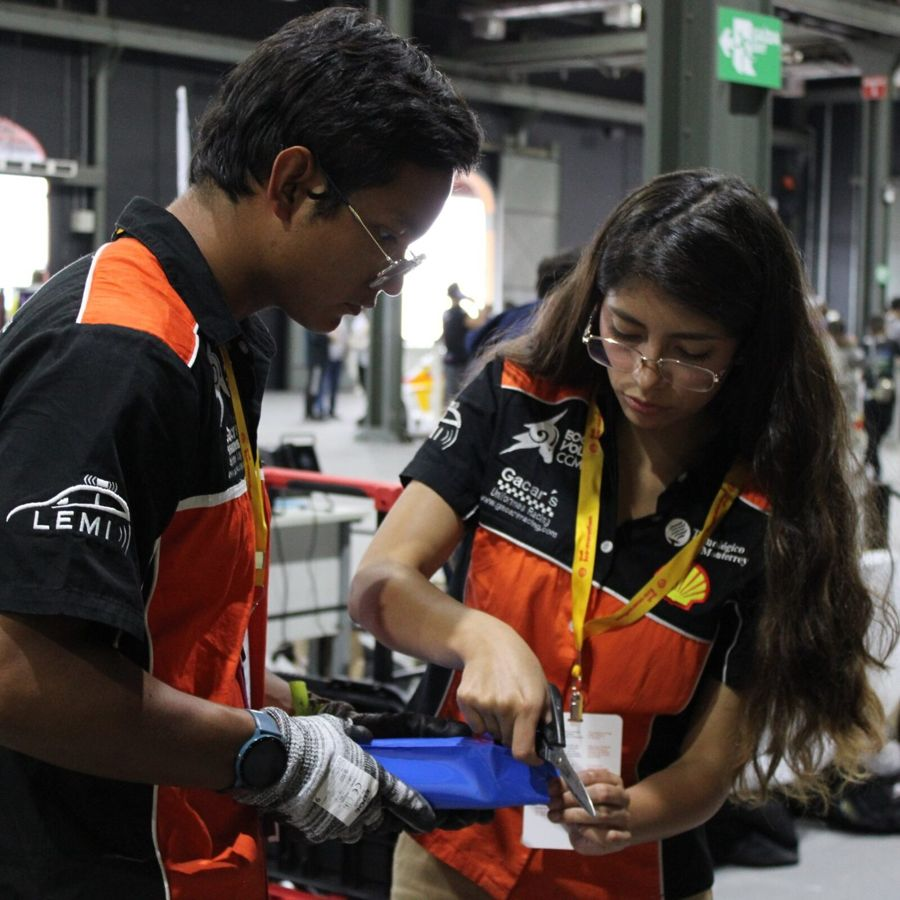<figcaption><strong>Fahrerlager</strong>Fahrzeugelektronik vor Ort</figcaption></figure>
  <figure class="hm-tile hm-wide">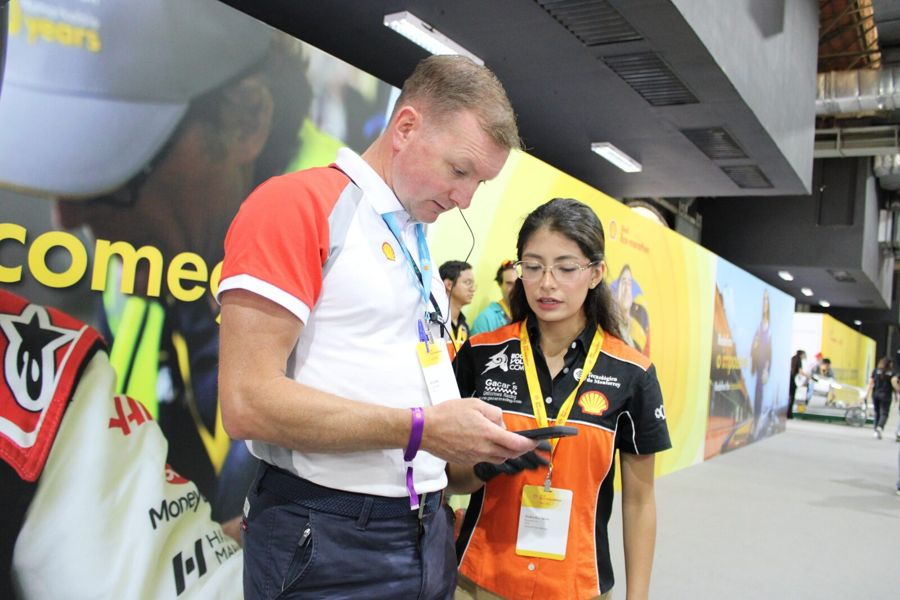<figcaption><strong>Unsere Systeme vorstellen</strong>Off-Track-Awards beim Shell Eco-marathon</figcaption></figure>

<h2 class="hm-h" id="experience">Praxis &amp; Studium</h2>

  
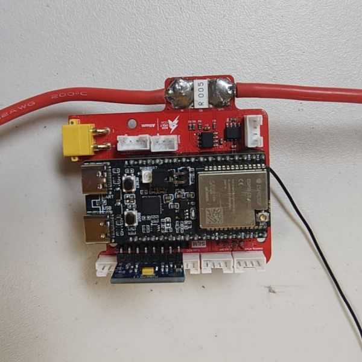

    
08/2023 – 08/2026

    
Teamkapitänin, Leiterin Elektronik &amp; Mentorin

    
Elektro-Rennteam EcoVolt CCM · Shell Eco-marathon

    <ul>
      <li>Leitung eines Teams mit ca. 30 Mitgliedern; energieeffizientes E-Fahrzeug mit ca. 200 km/kWh bei ca. 28 km/h</li>
      <li>Telemetrie-Platinen in Altium entwickelt und ESP32-Firmware in C++ geschrieben (CAN, SPI, I2C, UART)</li>
      <li>Data &amp; Telemetry Award: 1. Platz 2025, 2. Platz 2026 · Vehicle Design Award 2026</li>
    </ul>
    <a class="hm-more" href="/de/projects/ecovolt-telemetry/">Zum Telemetrie-Projekt →</a>
  

  
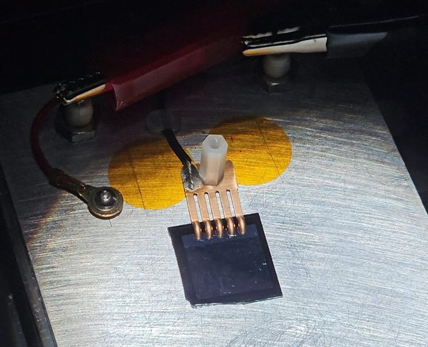

    
10/2025

    
Gaststudentin — NanoLab Microfabrication Program

    
MIT.nano · Massachusetts Institute of Technology

    <ul>
      <li>Solarzelle, MEMS-Cantilever und Mikrofluidik-Mischer gefertigt (Lithografie, PECVD/PVD, Ätzen)</li>
      <li>Bauelemente charakterisiert: IV-Kennlinie, mechanische und Fluidtests</li>
    </ul>
    <a class="hm-more" href="/de/projects/mit-nano-fabrication/">Zum MIT.nano-Projekt →</a>
  

  
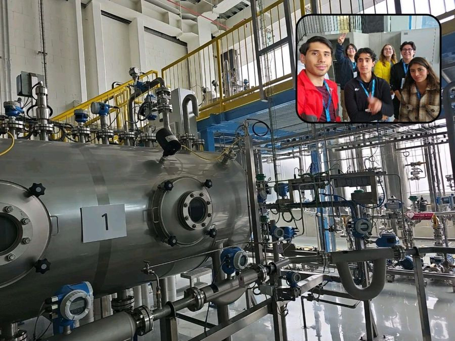

    
2025 – 2026

    
Projekte mit Industriepartnern

    
Endress+Hauser · ORZA Tech · mit dem Tecnológico de Monterrey

    <ul>
      <li>Messelektronik für ein Viskositätssystem auf drei eigenen Platinen — 252 cP und 1676 cP zuverlässig unterschieden</li>
      <li>Digitaler Zwilling einer CNC-Zelle: S7-1500 mit 35-stufiger Ablaufkette, SCADA und KPI (Yield, Ausschuss, OEE)</li>
    </ul>
    <a class="hm-more" href="/de/projects/">Alle Projekte →</a>
  

  
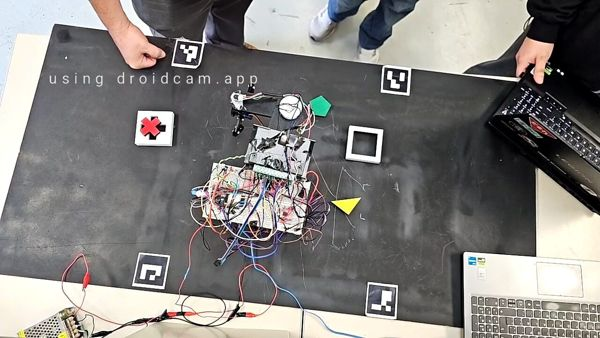

    
08/2023 – 12/2027

    
Studium: B.Sc. Mechatronik &amp; B.Eng. Elektrotechnik (DHIK-Doppelabschluss)

    
Tecnológico de Monterrey · Hochschule Zittau/Görlitz (seit 09/2026)

    <ul>
      <li>Notenschnitt 92/100 (≈ 1,8) · Leistungsstipendium (30 %)</li>
      <li>Aktuelle Module: Kollaborative Roboter, Neuronale Netze, Mikrocontroller, Bildverarbeitung, Advanced Control Theory</li>
    </ul>
  

## Ausgewählte Projekte



  <a href="{{ project.url | relative_url }}" style="display:block; border:1px solid currentColor; border-radius:8px; overflow:hidden; text-decoration:none;">
    
    
    
    

      <h3 style="font-weight:bold; margin:0 0 0.5rem 0;">{{ project.title }}</h3>
      
{{ project.description }}

    

  </a>


[Alle Projekte ansehen →](/de/projects/)
