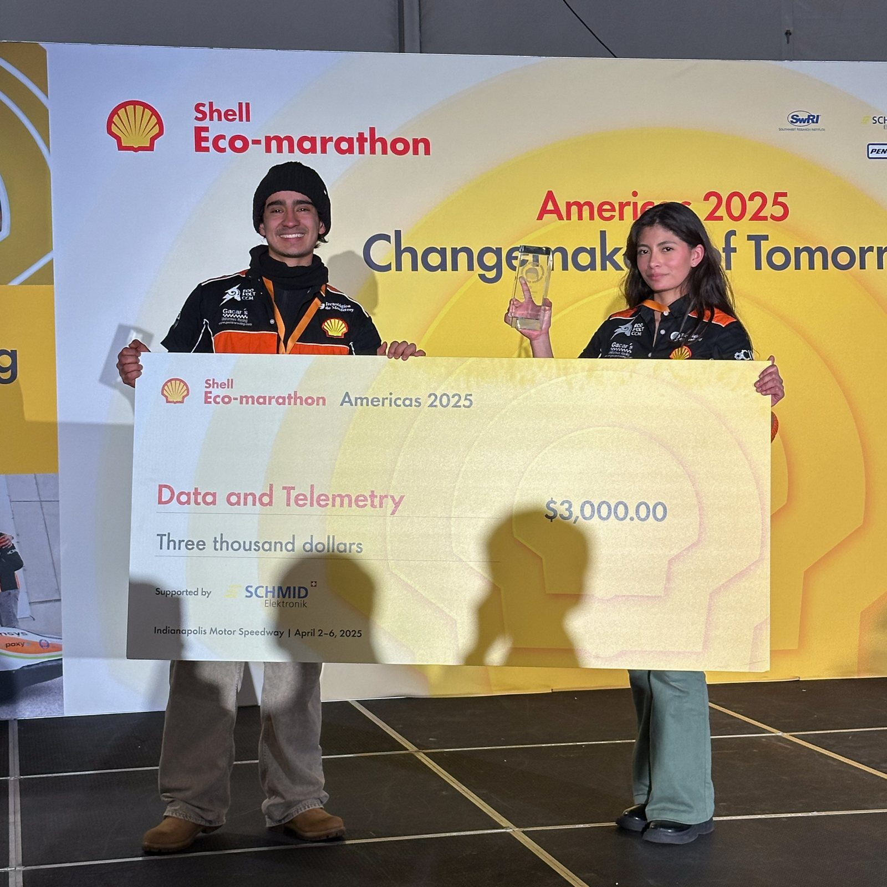
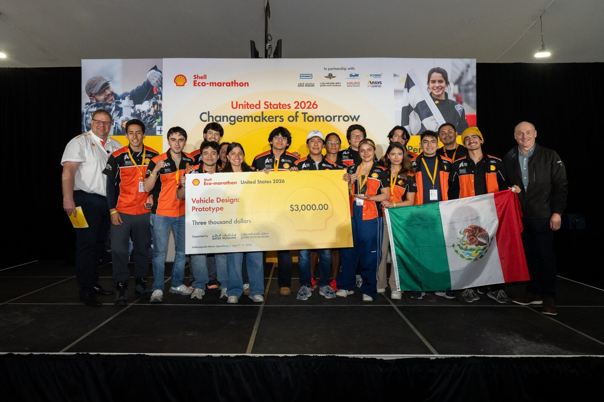
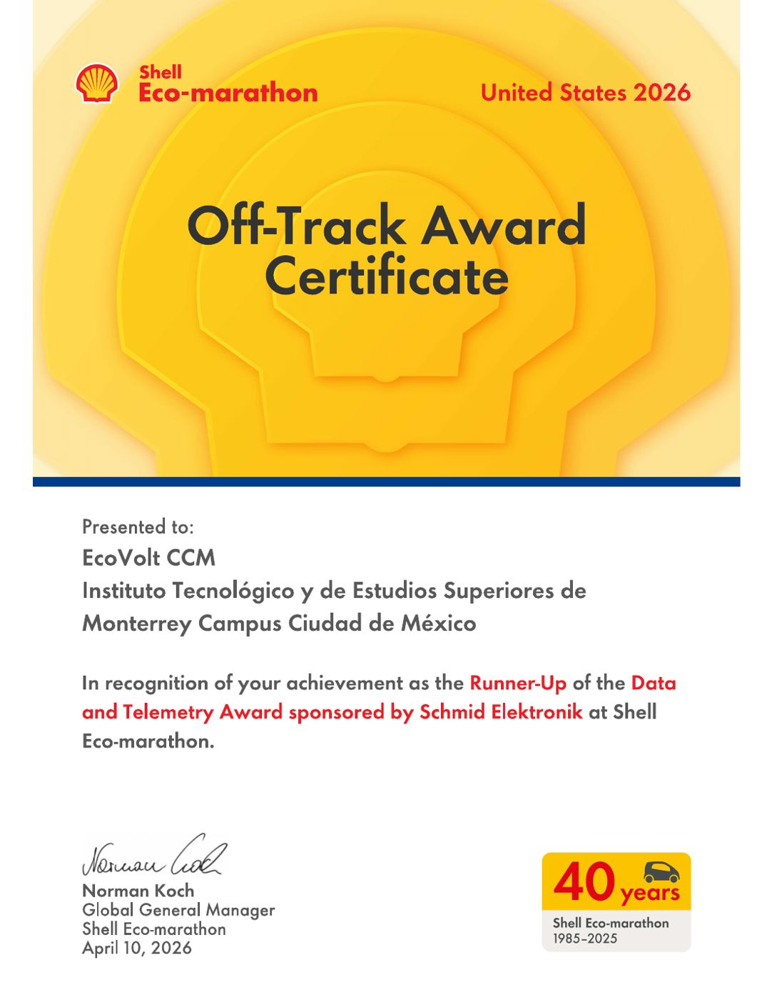
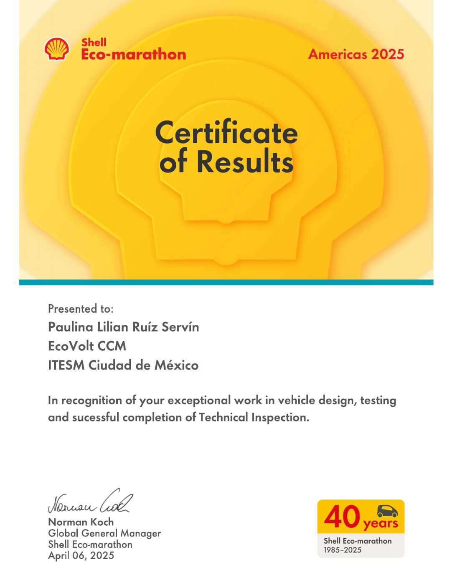

Logros

Premios, investigación y certificaciones de mi trabajo en competencias, cuarto limpio y automatización — cada uno con su documento de respaldo.

  
<b>3</b>premios internacionales

  
<b>4</b>competencias Shell Eco-marathon

  
<b>12</b>certificaciones técnicas

  
<b>1</b>artículo IEEE (primera autora)

<h2 class="ach-h sec-h" id="awards"><i class="fa-solid fa-trophy"></i> Premios</h2>

Escudería EcoVolt CCM EV Racing Team — Capitana del equipo y líder de electrónica, 2023–2026

  

    
    

      🥇 Ganador · 3,000 USD
      
Data &amp; Telemetry Award

      
Shell Eco-marathon Americas 2025 · patrocinado por Schmid Elektronik

      
Por el primer sistema de telemetría que cofundé: corriente, voltaje y GPS en vivo del auto a los pits.

      <a class="ach-link" href="/es/projects/ecovolt-telemetry/">Ver el proyecto de telemetría →</a>
    

  

  

    
    

      🥇 Ganador · 3,000 USD
      
Vehicle Design Award — Prototype

      
Shell Eco-marathon United States 2026 · patrocinado por Qatar Museums

      
Mi aporte: el análisis ergonómico del piloto (modelo humano virtual, RULA) que definió la cabina.

      <a class="ach-link" href="/es/projects/ecovolt-telemetry/#driver-ergonomics-vehicle-design-award">Ver el trabajo de ergonomía →</a>
    

  

  

    
    

      🥈 Segundo lugar · 1,500 USD
      
Data &amp; Telemetry Award

      
Shell Eco-marathon United States 2026 · patrocinado por Schmid Elektronik

      
Por el sistema V2 rediseñado: PCB propio, CAN al controlador del motor y registro en tarjeta SD.

      <a class="ach-link" href="/es/projects/ecovolt-telemetry/">Ver el proyecto de telemetría →</a>
    

  

  

    
    

      🏅 Mención honorífica
      
Altair Global Student Contest 2025

      
Con José Diego González Fernández (ITESM)

      
"AI-Driven Data Analysis for Vehicle Energy Efficiency": Altair AI Studio aplicado a datos de competencia para jerarquizar los factores de la eficiencia.

      <a class="ach-link" href="https://web.altair.com/global-student-contest-2025" target="_blank" rel="noopener">Página del concurso →</a>
    

  

<h2 class="ach-h sec-h"><i class="fa-solid fa-file-lines"></i> Investigación e informes</h2>

  

    <strong>📄 IEEE SAIBOT 2026 — primera autora (aceptado)</strong>
    
<em>Real-Time Telemetry and Computational Intelligence Pipeline for Energy-Efficient Driving of an Electric Eco-Marathon Vehicle</em>

    
<a href="/es/publications/">Ver publicaciones →</a>

  

  

    <strong>🔬 MIT.nano Lab — informe técnico (oct. 2025)</strong>
    
Micro/Nanofabrication Processing Technology: celda solar de silicio tipo n, cantilevers MEMS y mezclador microfluídico, bajo la supervisión del Dr. Javier Izquierdo Reyes y el Dr. Arnoldo Salazar Soto.

    
<a href="/es/projects/mit-nano-fabrication/">Ver el proyecto de MIT.nano →</a>

  

<h2 class="ach-h sec-h" id="certifications"><i class="fa-solid fa-certificate"></i> Certificaciones de un vistazo</h2>

  

Siemens

Process Simulate Standalone Associate

jun. 2026

  

Dassault Systèmes

Certified SOLIDWORKS Associate (CSWA)

ago. 2026

  

Universal Robots

Educational Robotics Core + e-Series Core, Pro &amp; Application Tracks

mar. – oct. 2026

  

MiR Academy

Personnel Safety, Autonomous Navigation, Mission Programming

oct. 2026

  

MathWorks

Simulink Onramp &amp; Simscape Onramp

oct. 2026

  

Altium Education

PCB Basic Design

feb. 2026

<h2 class="sec-h" id="all-certificates--award-documents"><i class="fa-solid fa-folder-open"></i> Todos los certificados y documentos de premios</h2>

<!--- ### Certificate viewer --->
<!--- Flip through my certificates and award documents, grouped by Electrical Engineering, Automation and Shell Eco-marathon, each in chronological order. --->

Usa las flechas, el teclado (← →), desliza en el celular o toca una miniatura.

  

    <button class="certbook-btn prev" type="button" aria-label="Certificado anterior">&#8249;</button>
    

      
        <figure class="certbook-sheet active" data-caption="{{ c.caption | escape }}" data-group="{{ c.group | escape }}">
          
        </figure>
      
    

    <button class="certbook-btn next" type="button" aria-label="Certificado siguiente">&#8250;</button>
  

  

  

    
    <a class="btn btn-sm z-depth-0" href="{{ '/assets/pdf/Certificates_Paulina_Ruiz.pdf' | relative_url }}" target="_blank" rel="noopener">Abrir PDF completo</a>
  

  

    
      <button type="button" class="certbook-thumb active" data-i="{{ forloop.index0 }}" aria-label="{{ c.caption | escape }}">
        
      </button>
    
  

  <a class="btn btn-sm z-depth-0" role="button" href="{{ '/es/projects/' | relative_url }}">← Anterior: Proyectos</a>
  <a class="btn btn-sm z-depth-0" role="button" href="{{ '/es/publications/' | relative_url }}">Siguiente: Publicaciones →</a>

